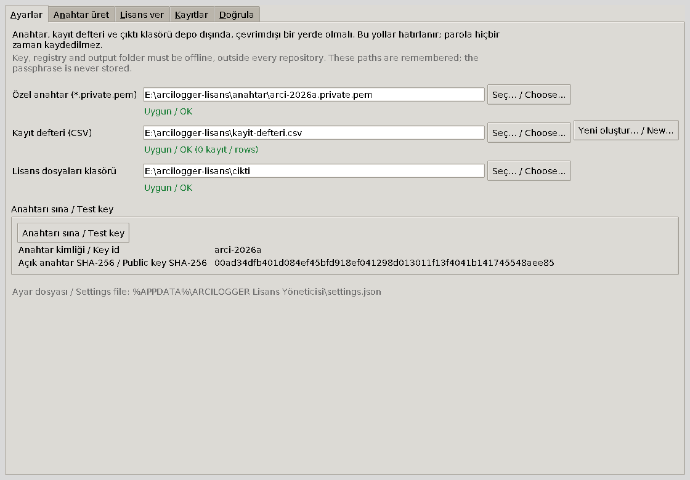
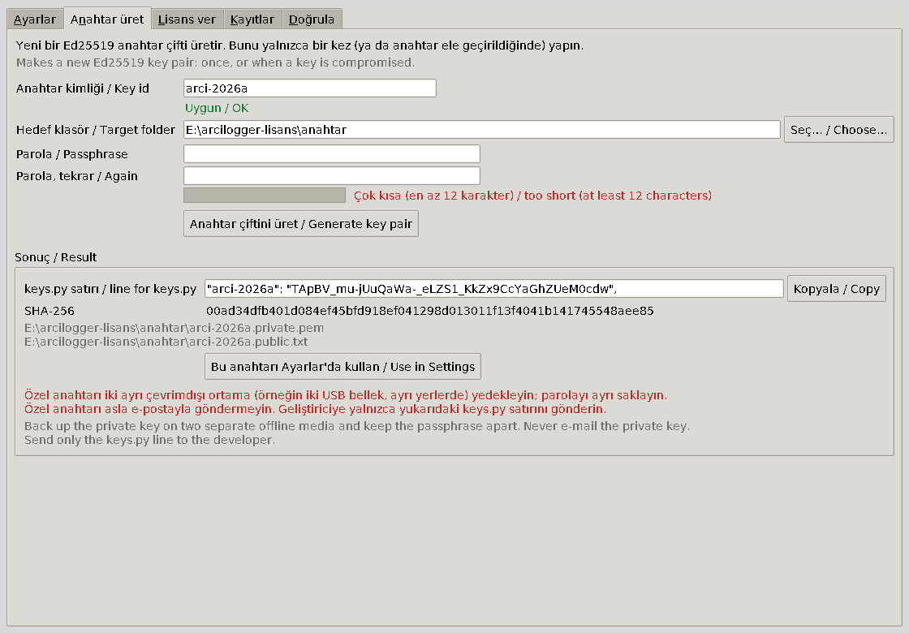
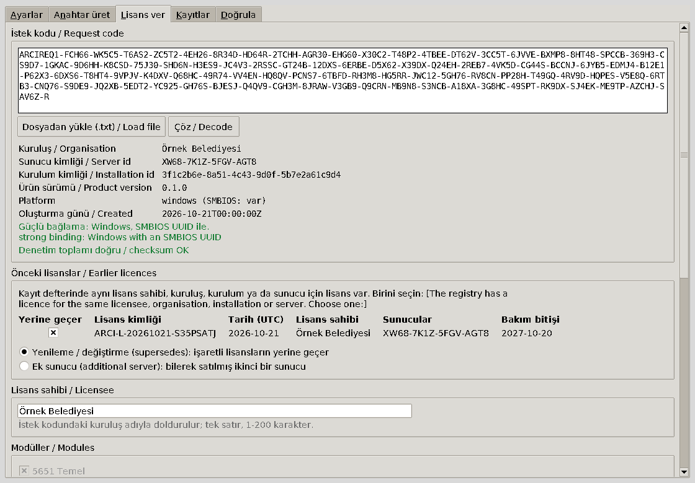
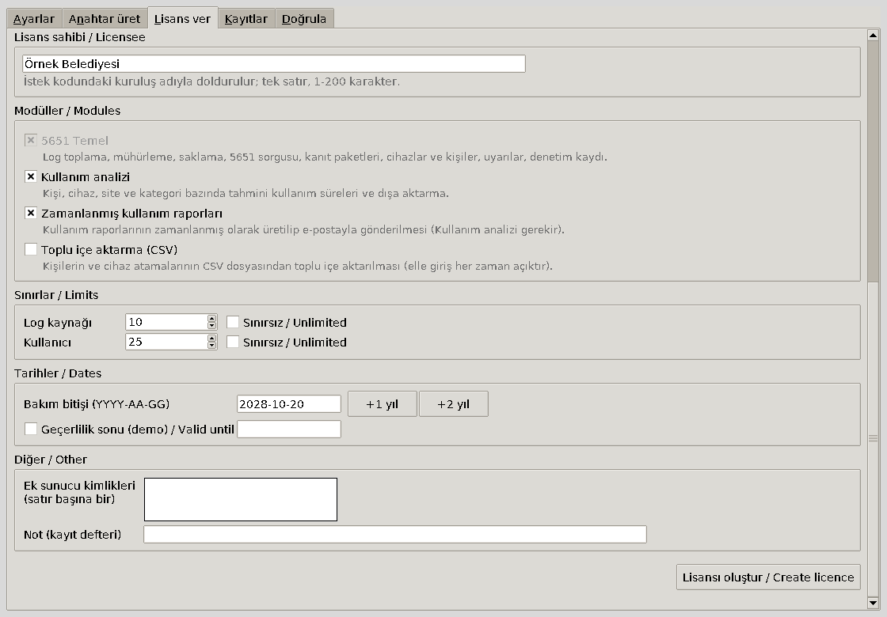
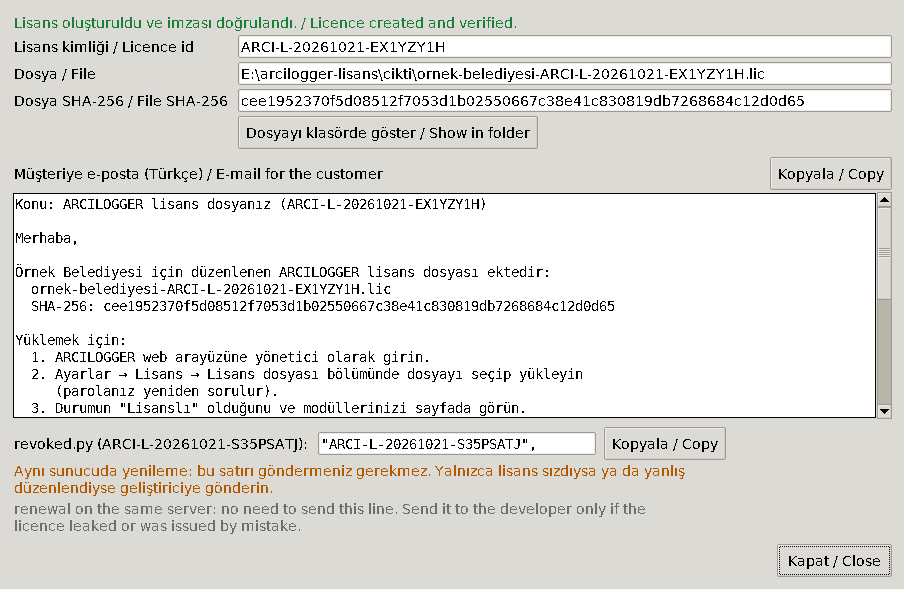
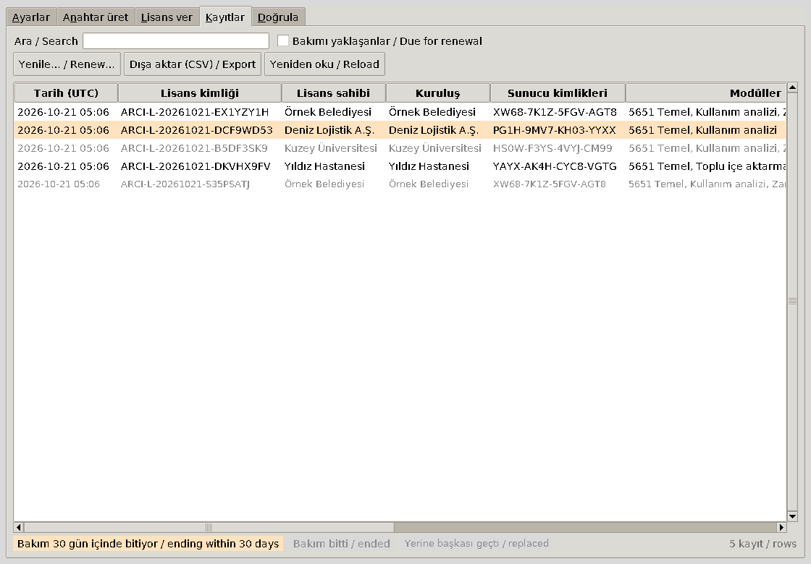
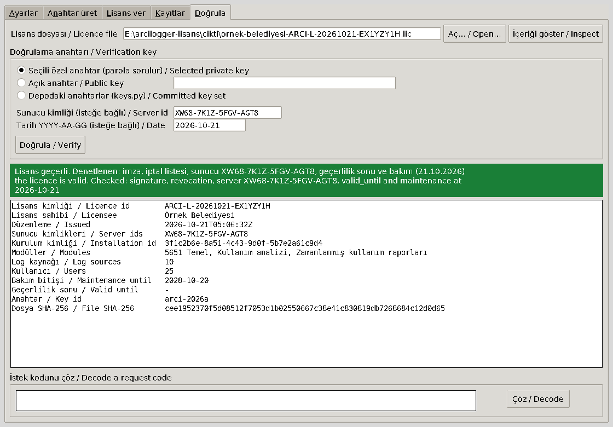

# Lisans Yöneticisi ve lisans düzenleyici / Licence Manager and licence issuer (`tools/license-issuer`)

> **Yalnızca hak sahibi için / for the rights holder only.** Bu araçlar ARCILOGGER lisans
> dosyalarını (`.lic`) imzalar. Ürün paketine girmez, müşteriye verilmez, ağ bağlantısı kurmaz ve
> **internete bağlı olmayan** bir bilgisayarda çalıştırılır. Özel anahtar, parolası ve lisans kayıt
> defteri hiçbir zaman bu depoya (ya da başka bir depoya) girmez.

İki yol vardır ve ikisi de aynı kodu kullanır (aynı kurallar, aynı kayıt defteri):

- **Lisans Yöneticisi** (grafik arayüz, önerilen): tek bir zip dosyası; kurulum gerekmez
  (bölüm A).
- **Komut satırı** (`arcilogger_license_issuer.py`): betikler ve depo çalışma kopyası için
  (bölüm B).

English: [below](#english).

## Türkçe

### A. Lisans Yöneticisi (grafik arayüz)

"ARCILOGGER Lisans Yöneticisi" penceresinin beş sekmesi vardır: **Ayarlar**, **Anahtar üret**,
**Lisans ver**, **Kayıtlar**, **Doğrula**; **Yardım → Hakkında** sürümü gösterir. Her ret,
Türkçe metni ve altında İngilizcesiyle bir pencerede görünür. Komut satırıyla aynı denetimler
yapılır: anahtar kimliği, modüller, sınırlar, tarih biçimi, zayıf bağlama, önceki lisanslar ve
kayıt defterinin başlığı.

#### A.1 Paketi indirmek (GitHub Actions)

1. GitHub'da depoyu açın: **Actions** → solda **Lisans Yöneticisi (Windows zip)**.
2. Yeşil (başarılı) son çalıştırmayı açın. Yoksa ya da yeni bir paket istiyorsanız
   **Run workflow** düğmesiyle yeniden oluşturun (gizli bilgi gerekmez).
3. Sayfanın altındaki **Artifacts** bölümünden **ARCILOGGER-Lisans-Yoneticisi** dosyasını indirin.
   GitHub bunu bir zip içinde verir; içinden `ARCILOGGER-Lisans-Yoneticisi-<sürüm>.zip` ve
   `ARCILOGGER-Lisans-Yoneticisi-<sürüm>.zip.sha256` çıkar.
4. Özeti denetleyin (iki değer aynı olmalı):

   ```powershell
   (Get-FileHash .\ARCILOGGER-Lisans-Yoneticisi-0.1.0.zip -Algorithm SHA256).Hash.ToLower()
   Get-Content .\ARCILOGGER-Lisans-Yoneticisi-0.1.0.zip.sha256
   ```

5. Zip dosyasını bir USB bellekle çevrimdışı bilgisayara taşıyın.

Paketi depodan kendiniz de oluşturabilirsiniz (internete bağlı bir Windows bilgisayarda, `uv`
kurulu): `powershell -ExecutionPolicy Bypass -File tools\license-issuer\Build-LicenseManager.ps1`.
Betik, kurulum paketinin doğruladığı Python'u (`deploy/windows/installer/components.json`,
SHA-256 denetimiyle) ve `uv.lock`'taki sürümleri kullanır.

#### A.2 Açmak ve başlatmak

1. Zip dosyasına sağ tıklayın → **Özellikler** → **Engellemeyi kaldır** → **Tamam** (internetten
   gelen dosyalarda Windows uyarısını önler).
2. Zip'i bir klasöre açın, örneğin `E:\arcilogger-lisans\program\`. Kurulum ve yönetici hakkı
   gerekmez; Python `python\` klasörünün içindedir. Açılan klasörde
   **`ARCILOGGER-Lisans-Yoneticisi-<sürüm>`** klasörüne girin (Windows'un "Tümünü ayıkla" komutu
   aynı adla bir klasör daha ekleyebilir: `.cmd` dosyalarını ve `python` klasörünü görene kadar
   girin).
3. **`ARCILOGGER Lisans Yöneticisi.cmd`** dosyasına çift tıklayın.
4. İsterseniz önce öz sınamayı çalıştırın (geçici bir anahtar, kayıt defteri ve istek koduyla
   tam bir tur; sonunda "başarılı" yazar). Bu klasörde Dosya Gezgini'nin adres çubuğuna `cmd`
   yazıp Enter'a basın; açılan komut penceresine şunu yazın:

   ```text
   python\python.exe -I -m arcilogger_license_gui --self-test
   ```

Ayarlar `%APPDATA%\ARCILOGGER Lisans Yöneticisi\settings.json` dosyasında tutulur: yalnızca üç
yol, **parola asla**. Kılavuzun bu kopyası zip içinde `kilavuz\README.md` dosyasıdır.

#### A.3 Ayarlar



- **Özel anahtar (`*.private.pem`):** "Anahtar üret" sekmesinin yazdığı dosya (adı
  `<anahtar-kimliği>.private.pem` kalmalı).
- **Kayıt defteri (CSV):** var olanı seçin ya da **Yeni oluştur…** ile tam başlıklı boş bir
  defter açın (komut satırının yazdığı biçimle aynı). Pencere defteri kendiliğinden hiçbir zaman
  oluşturmaz: hatırlanan defter taşınmış ya da adı değişmişse "Kayıt defteri bulunamadı" yazar ve
  lisans verilmez (yoksa önceki lisanslar görünmez, defter ikiye bölünürdü). Defteri yeniden
  seçin.
- **Lisans dosyaları klasörü:** `.lic` dosyalarının önerileceği klasör.
- Üçü de depo dışında, çevrimdışı bir yerde olmalı: bir git çalışma ağacının içindeki yol
  (kendisinde ya da üst klasörlerinden birinde `.git` olan) reddedilir.
- **Anahtarı sına / Test key:** parolayı bir kez sorar; anahtar kimliğini ve açık anahtarın
  SHA-256 parmak izini gösterir. Parmak izini "Anahtar üret" sonucunda not ettiğiniz değerle
  karşılaştırın.

#### A.4 Anahtar üretmek ve yedeklemek



1. **Anahtar kimliği:** örneğin `arci-2026a` (`^[a-z0-9][a-z0-9-]{2,31}$`, `test-` ile başlamaz);
   yazarken denetlenir.
2. **Hedef klasör:** çevrimdışı bir klasör, örneğin `E:\arcilogger-lisans\anahtar`.
3. **Parola** iki kez (en az 12 karakter; gösterge yalnızca ipucudur). Uzun bir parola cümlesi
   seçin.
4. **Anahtar çiftini üret:** `arci-2026a.private.pem` (parolayla şifreli) ve
   `arci-2026a.public.txt` yazılır; var olan bir dosyanın üzerine asla yazılmaz. Parola kutuları
   hemen boşaltılır.
5. Sonuçta `keys.py` satırı (**Kopyala / Copy**) ve SHA-256 özeti görünür. **Bu anahtarı
   Ayarlar'da kullan** ile ayarlara geçin.

**Yedekleme:** şifreli özel anahtarı **iki ayrı çevrimdışı ortama** (örneğin iki USB bellek, ayrı
yerlerde) kopyalayın; parolayı ayrı saklayın. Özel anahtarı asla e-postayla göndermeyin, bulut
klasörüne koymayın. Anahtar kaybolursa yeni lisans imzalanamaz; ele geçirilirse herkes lisans
üretebilir.

#### A.5 Açık anahtar satırını göndermek

Geliştiriciye **yalnızca** `keys.py` satırını gönderin (`"arci-2026a": "<43 karakter>",`) ve SHA-256
özetini telefonla ya da ayrı bir yoldan doğrulayın. Satır
[`core/src/arcilogger_core/license/keys.py`](../../core/src/arcilogger_core/license/keys.py)
içindeki `TRUSTED_KEYS` sözlüğüne eklenir; o sürümden sonraki her sürüm bu anahtarla imzalanmış
lisansları tanır. Satır eklenene kadar ürün yalnızca deneme ya da lisanssız modda çalışır.

#### A.6 İlk lisansı vermek



1. Müşterinin e-postayla gönderdiği istek kodunu (`ARCIREQ1-…`) kutuya yapıştırın ya da
   **Dosyadan yükle (.txt)** ile açın; **Çöz / Decode**'a basın. E-postanın eklediği satır
   sonları, boşluklar ve küçük harfler önemli değildir.
2. Kuruluş, sunucu kimliği, kurulum kimliği, ürün sürümü ve platform görünür. **Güçlü bağlama**
   yeşil (Windows, SMBIOS UUID), **zayıf bağlama** turuncudur (Linux ya da SMBIOS UUID'siz
   Windows: sunucu kimliği tek bir düzenlemeyle başka makineye taşınabilir). Zayıf bir istek için
   "Zayıf bağlamaya izin ver" kutusu görünür; yalnızca bilerek işaretleyin.
3. **Önceki lisanslar:** kayıt defterinde aynı lisans sahibi, kuruluş, kurulum ya da sunucu için
   lisans varsa tablo görünür ve bir seçim zorunludur: **Yenileme / değiştirme (supersedes)**
   (yerine geçtiği lisansları işaretleyin) ya da **Ek sunucu** (bilerek satılmış ikinci bir
   sunucu). İlk lisansta tablo görünmez.



4. **Lisans sahibi:** istek kodundaki kuruluş adıyla dolar; düzeltebilirsiniz (tek satır,
   1–200 karakter).
5. **Modüller:** "5651 Temel" her zaman işaretli ve değiştirilemez. "Zamanlanmış kullanım
   raporları" "Kullanım analizi"ni gerektirir: birini işaretlemek ötekini işaretler,
   "Kullanım analizi"ni kaldırmak raporları da kaldırır.
6. **Sınırlar:** log kaynağı ve kullanıcı sayısı (1–100000) ya da **Sınırsız**.
7. **Bakım bitişi:** varsayılan bugünden bir yıl sonrasının bir gün öncesi; **+1 yıl**, **+2 yıl**
   düğmeleri. Tarih `YYYY-AA-GG` ya da `GG.AA.YYYY` biçiminde yazılabilir. Bu tarihten sonra
   yayımlanan sürümler yalnızca 5651 Temel ile çalışır; lisans süresizdir. Bugünden önceki bir
   bakım bitişi için pencere, parolayı sormadan önce devam edilip edilmeyeceğini sorar.
   **Geçerlilik sonu** yalnızca demo lisansı içindir (kutuyla açılır); müşteri e-postası o zaman
   lisansın bir deneme lisansı olduğunu ve o tarihten sonra ücretli modüllerin kapandığını söyler.
8. İsteğe bağlı: ek sunucu kimlikleri (satır başına bir) ve kayıt defterine bir not.
9. **Lisansı oluştur / Create licence:** önce her şey denetlenir ve bütün hatalar birlikte
   gösterilir; sonra parola sorulur (gizli kutu). Lisans imzalanır, açık anahtarla doğrulanır ve
   `<lisans-sahibi>-<lisans-kimliği>.lic` adıyla lisans klasörüne kaydedilmesi önerilir. Önce
   kayıt defterine satır eklenir, sonra dosya yazılır.



10. Sonuç penceresi: lisans kimliği, dosyanın SHA-256 özeti, **Dosyayı klasörde göster** ve
    müşteriye gönderilecek Türkçe e-posta metni (**Kopyala**; dosyanın Ayarlar → Lisans → Lisans
    dosyası bölümünden nasıl yükleneceğini anlatır). `.lic` dosyasını bu e-postaya ekleyin.
11. Pencere kapanınca "Lisans ver" ekranı boşalır: sonraki müşteri için lisans sahibi, ek
    sunucular, not, modüller, sınırlar ve tarihler baştan başlar. Bir müşterinin lisansı için
    işaretlenen "yerine geçer" kutusu başka bir müşterinin istek koduna taşınmaz.

#### A.7 Yenilemek (bakım uzatma)



1. **Kayıtlar** sekmesinde **Bakımı yaklaşanlar** kutusuyla yenilenecek lisansları görün
   (turuncu: bakım 30 gün içinde bitiyor; gri: bitti; gri ve eğik: yerine yeni bir lisans geçti,
   "Yerine geçen" sütunu hangisi olduğunu gösterir). "Tarih (UTC)" sütunu düzenleme zamanını UTC
   olarak gösterir (Türkiye saati UTC+3).
2. Satırı seçip **Yenile… / Renew…**'e basın (ya da çift tıklayın ya da Enter): "Lisans ver" aynı
   lisans sahibi, modüller, sınırlar ve ek sunucularla açılır, bakım bitişi eski tarih + 1 yıldır
   (eski bakım bittiyse bugünden bir yıl) ve eski satır "yerine geçer" olarak işaretlidir. Ek
   sunuculardan biri artık kullanılmıyorsa kutudan silin.
3. Müşteriden **yeni bir istek kodu** isteyin (komut satırındaki gibi zorunludur), yapıştırıp
   çözün ve lisansı oluşturun.
4. Aynı sunucuda yenilemede `revoked.py` satırını göndermeniz gerekmez (sonuç penceresi bunu
   söyler).

#### A.8 Sunucu değişikliği

1. Müşteri yeni sunucudaki kurulumun istek kodunu gönderir.
2. "Lisans ver"de kodu çözün; önceki lisans tabloda görünür. **Yenileme / değiştirme**'yi seçip
   eski lisansı işaretleyin ve lisansı oluşturun.
3. Sonuç penceresindeki `revoked.py` satırını (`"ARCI-L-…",`, **Kopyala**) geliştiriciye gönderin:
   sunucu değiştiğinde ya da bir lisans sızdığında. İptal, yalnızca bu satırı içeren bir sürüme
   yükseltilen kurulumlarda geçerli olur (ürün hiçbir zaman ağa bağlanmaz).

#### A.9 Doğrulamak



- **Lisans dosyası**nı açın. **İçeriği göster** dosyayı imza denetlemeden gösterir (`inspect`).
- **Doğrula**: seçili özel anahtarla (parola sorulur), yapıştırılan bir açık anahtarla ya da
  depodaki anahtar kümesiyle (`keys.py`) imzayı ve iptal listesini denetler; isteğe bağlı olarak
  sunucu kimliğini ve bir günü (o gün yayımlanan sürüm bakım kapsamında mı, `valid_until`
  geçti mi). Sonuç yeşil (geçerli) ya da kırmızıdır (hata kodu ve Türkçe/İngilizce metin).
- Aynı sekmenin altında bir istek kodu da çözülebilir.

#### A.10 Kayıt defteri ve dışa aktarma

- **Kayıtlar** sekmesi defteri yalnızca okur; arama bütün sütunlarda yapılır, sütun başlığına
  tıklamak sıralar.
- **Dışa aktar (CSV)** defterin bir kopyasını (muhasebe için) yazar; defterin kendisi hiçbir zaman
  yeniden yazılmaz. Var olan bir dosyanın (ve özel anahtarın) üzerine yazılmaz: yeni bir ad
  seçin. Defteri düzenli olarak yedekleyin.
- Defter Excel'de açıkken Windows dosyayı kilitler; lisans verirken "Dosya başka bir program
  tarafından kullanılıyor" yazarsa Excel'i kapatıp yeniden deneyin.

#### A.11 Güvenlik

- Ağ bağlantısı, telemetri ya da güncelleme denetimi yoktur.
- Parola yalnızca gizli kutulara yazılır; ayarlara, kayıtlara, panoya, ortam değişkenlerine ya da
  komut satırına hiçbir zaman girmez ve kullanıldıktan hemen sonra silinir. Özel anahtar nesnesi
  imzadan hemen sonra bırakılır.
- Pencere bütün kararları komut satırı aracının ortak işlevlerinden ve `arcilogger_core.license`'tan
  alır: tek bir uygulama vardır.

### B. Komut satırı (alternatif)

Zip paketinde komut satırı aracı **`Lisans Aracı (komut satırı).cmd`** dosyasıdır; aşağıdaki
`uv run python tools/license-issuer/arcilogger_license_issuer.py` yerine bunu yazın. Komut
penceresini paketin klasöründe açın (adres çubuğuna `cmd`, Enter), örneğin
`"Lisans Aracı (komut satırı).cmd" verify ornek.lic --committed-keys`. PowerShell'de başına `&`
ve `.\` gelir: `& ".\Lisans Aracı (komut satırı).cmd" verify ornek.lic --committed-keys`.

#### Ne yapar

| Komut | İş |
|---|---|
| `keygen` | Yeni bir Ed25519 anahtar çifti üretir: parolayla şifrelenmiş özel anahtar (`<kimlik>.private.pem`) ve `keys.py` dosyasına eklenecek açık anahtar satırı (`<kimlik>.public.txt`). |
| `issue` | Müşterinin istek kodundan lisans dosyası (`.lic`) imzalar, açık anahtarla doğrular ve kayıt defterine (CSV) bir satır ekler. |
| `inspect` | Bir `.lic` dosyasını ya da istek kodunu, hiçbir güven kararı vermeden gösterir. |
| `verify` | Bir `.lic` dosyasının imzasını (ve isteğe bağlı olarak sunucu kimliğini, tarihleri) denetler. |

Çıkış kodları: `0` tamam, `1` reddedildi / geçersiz, `2` kullanım hatası. Her mesaj önce Türkçe,
sonra köşeli parantez içinde İngilizce yazılır.

Bütün komutlar deponun kökünden çalıştırılır (aynı biçim tanımını, `arcilogger_core.license`'ı
kullanır):

```text
uv run python tools/license-issuer/arcilogger_license_issuer.py --help
```

#### B.1 Hazırlık: çevrimdışı bilgisayar

- Ağa bağlı olmayan (ya da bu iş sırasında ağdan çıkarılmış) bir bilgisayar kullanın.
- Bu depoyu oraya kopyalayın ve `uv sync` ile ortamı kurun (bağımlılıkları önceden indirin).
- Anahtarlar ve kayıt defteri için depo **dışında** bir klasör seçin, örneğin `E:\arcilogger-lisans\`.
  Araç, bir git çalışma ağacının içindeki (kendisinde ya da üst klasörlerinden birinde `.git`
  bulunan) klasörü reddeder.

#### B.2 Anahtar çifti (`keygen`)

```text
uv run python tools/license-issuer/arcilogger_license_issuer.py keygen --key-id arci-2026a --out E:\arcilogger-lisans\anahtar
```

- Anahtar kimliği `^[a-z0-9][a-z0-9-]{2,31}$` biçimindedir ve `test-` ile başlamaz (örnek:
  `arci-2026a`).
- Parola iki kez sorulur, en az 12 karakterdir. Betikli kullanımda `--passphrase-file DOSYA`
  verilebilir (dosyanın ilk satırı); parola hiçbir zaman komut satırına ya da bir ortam
  değişkenine yazılmaz.
- Çıktı: `arci-2026a.private.pem` (PKCS#8, parolayla şifreli; POSIX'te izin 0600) ve
  `arci-2026a.public.txt` (tek satır: `"arci-2026a": "<43 karakter>",`). Ekranda açık anahtar,
  SHA-256 özeti ve `verify` için yapıştırmaya hazır `verify: --public-key=<43 karakter>` satırı
  görünür; özeti not edin.
- Var olan bir dosyanın üzerine yazılmaz.

**Yedekleme:** şifreli özel anahtarı **iki ayrı çevrimdışı ortama** (örneğin iki USB bellek, ayrı
yerlerde) yedekleyin. Parolayı ayrı saklayın. Anahtar kaybolursa yeni lisans imzalanamaz; ele
geçirilirse herkes lisans üretebilir.

#### B.3 Açık anahtarı ürüne eklemek

- Yalnızca `.public.txt` dosyasındaki **tek satırı** gönderin. Bu satır
  [`core/src/arcilogger_core/license/keys.py`](../../core/src/arcilogger_core/license/keys.py)
  içindeki `TRUSTED_KEYS` sözlüğüne bir değişiklik isteğiyle (pull request) eklenir.
- O sürümden sonraki her sürüm bu anahtarla imzalanmış lisansları tanır. Ürün başka hiçbir yerden
  (ortam değişkeni, yapılandırma dosyası, veritabanı, API) anahtar kabul etmez.
- Bu satır eklenene kadar ürün yalnızca deneme ya da lisanssız modda çalışır.

#### B.4 Lisans düzenlemek (`issue`)

Müşteri, kurulumun gösterdiği istek kodunu (`ARCIREQ1-…`) e-postayla gönderir. E-posta
programının eklediği satır sonları, boşluklar, küçük harfler ya da kaybolan tireler önemli
değildir; yanlış yazılmış bir karakteri denetim toplamı yakalar.

```text
uv run python tools/license-issuer/arcilogger_license_issuer.py issue ^
  --key E:\arcilogger-lisans\anahtar\arci-2026a.private.pem ^
  --request-file E:\arcilogger-lisans\istekler\ornek.txt ^
  --licensee "Örnek A.Ş." ^
  --modules usage_analytics,usage_reports ^
  --max-sources 10 --max-users 25 ^
  --maintenance-until 2027-10-20 ^
  --registry E:\arcilogger-lisans\kayit-defteri.csv ^
  --out E:\arcilogger-lisans\cikti\ornek.lic
```

- `--request CODE` ya da `--request-file DOSYA`: istek kodu. Araç kodu çözer ve sunucu kimliğini,
  kurulum kimliğini, ürün sürümünü, kuruluş adını, `platform` ve `smbios` değerlerini gösterir.
- `--modules`: virgülle ayrılmış modül anahtarları; `core_5651` (5651 Temel) her zaman eklenir.
  Bilinen anahtarlar: `usage_analytics` (Kullanım analizi), `usage_reports` (Zamanlanmış kullanım
  raporları; Kullanım analizi gerekir), `bulk_import` (Toplu içe aktarma, CSV). Bilinmeyen anahtar
  ya da eksik ön koşul kullanım hatasıdır (çıkış 2).
- `--max-sources` / `--max-users`: 1–100000 ya da `unlimited`.
- `--maintenance-until YYYY-AA-GG`: bakım bitişi (o gün dahil). Bu tarihten sonra yayımlanan
  sürümler yalnızca 5651 Temel ile çalışır; lisans süresiz kalır.
- `--valid-until YYYY-AA-GG`: yalnızca demo ya da süreli deneme lisansı için; normal satışta
  verilmez.
- `--extra-server-id ID` (birden çok kez): aynı lisansta başka sunucu kimlikleri (en çok 16).
- `--note METİN`: kayıt defterine not. `--force`: var olan `.lic` dosyasının üzerine yazar.
- Lisans kimliği `ARCI-L-<UTC YYYYAAGG>-<8 rastgele karakter>`, düzenleme zamanı şimdiki UTC
  zamandır. Araç dosyayı imzaladıktan sonra açık anahtarla doğrular, dosyayı yazar, kayıt
  defterine satırı ekler, özeti ve dosyanın SHA-256 özetini yazar.
- Özel anahtar dosyasının adı `keygen`'in yazdığı gibi `<kimlik>.private.pem` olmalıdır: anahtar
  kimliği bu addan okunur.

**Zayıf bağlama.** İstek Linux'tan geliyorsa ya da Windows'ta SMBIOS UUID'si yoksa (`platform`
`windows` değil ya da `smbios` `false`), sunucu kimliği tek bir düzenlemeyle başka bir makineye
taşınabilir. Araç böyle bir isteği reddeder (çıkış 1). Bilerek vermek için `--allow-weak-binding`
kullanın; kayıt defterine `binding = weak` yazılır. Bu değerleri müşterinin kurulumu kendisi
bildirir: dürüst ama zayıf kurulumlara karşı korur, kimliği taklit eden birine karşı korumaz.

**Önceki lisanslar.** Araç kayıt defterinde aynı lisans sahibine, aynı kuruluşa, aynı kurulum
kimliğine ya da ortak bir sunucu kimliğine ait her satırı "Önceki lisanslar / earlier licences"
başlığıyla gösterir. Böyle bir satır varsa şunlardan biri gerekir, yoksa hiçbir şey yazılmaz
(çıkış 1):

- `--supersedes LİSANS_KİMLİĞİ` (bir ya da birkaç kez): bu lisans öncekinin yerine geçer (sunucu
  değişikliği, düzeltme). Kimlik kayıt defterinde olmalıdır.
- `--additional-server`: bilerek satılmış ikinci bir sunucu.

#### B.5 Kayıt defteri (registry)

- Yalnızca eklenen bir CSV dosyası: UTF-8 (oluşturulurken BOM ile), `;` ayırıcı, CRLF satır
  sonu. `=`, `+`, `-`, `@` ile başlayan hücrelerin başına `'` eklenir (Excel bunları formül
  saymaz).
- Başlık, bu sırayla: `issued_at;license_id;licensee;organization;server_ids;installation_id;product_version;platform;binding;modules;max_sources;max_users;maintenance_until;valid_until;key_id;file_sha256;payload_sha256;request_sha256;supersedes;note`
  (listeler boşlukla ayrılır, sınırsız = boş; `binding` `strong` ya da `weak`; `supersedes`
  `--supersedes` kimlikleri, `--additional-server` için `additional`, yoksa boş).
- Var olan dosyanın başlığı tam olarak bu değilse araç hiçbir şey yazmaz. Satır eklendikten sonra
  dosya diske yazdırılır (`fsync`); hiçbir satır yeniden yazılmaz. Kayıt defterini elle
  düzenlemeyin; yedekleyin.
- Kayıt defteri depo dışında tutulur (bir git çalışma ağacının içindeki yol reddedilir).

#### B.6 Denetlemek (`inspect`, `verify`)

```text
uv run python tools/license-issuer/arcilogger_license_issuer.py inspect E:\arcilogger-lisans\cikti\ornek.lic
uv run python tools/license-issuer/arcilogger_license_issuer.py inspect --request ARCIREQ1-...
uv run python tools/license-issuer/arcilogger_license_issuer.py verify ornek.lic --committed-keys --server-id XW68-7K1Z-5FGV-AGT8 --at 2027-10-20
```

- `inspect`: içeriği gösterir, imzayı denetlemez (istek kodunda denetim toplamı denetlenir).
- `verify`: `--public-key=B64` (43 karakter; anahtar `-` ile başlayabildiği için `=` ile yazın,
  `keygen`'in yazdığı gibi),
  `--key PEM` (özel anahtardan) ya da
  `--committed-keys` (bu çalışma kopyasındaki `keys.py`) ile imzayı ve bu çalışma kopyasındaki
  iptal listesini denetler; `--server-id` ile sunucuyu; `--at YYYY-AA-GG` ile o güne göre
  `valid_until` ve bakım süresini (o gün yayımlanmış bir sürüm kapsanıyor mu). Geçerliyse 0,
  değilse hata koduyla 1 döner.

#### B.7 Sunucu değişikliği ve iptal

1. Müşteri yeni sunucudaki kurulumun istek kodunu gönderir.
2. Yeni lisansı `--supersedes <eski lisans kimliği>` ile düzenleyin.
3. Aracın yazdığı satırı (`"ARCI-L-…",`)
   [`core/src/arcilogger_core/license/revoked.py`](../../core/src/arcilogger_core/license/revoked.py)
   içindeki `REVOKED_LICENSE_IDS` kümesine bir değişiklik isteğiyle ekleyin.

İptal, yalnızca bu satırı içeren bir sürüme **yükseltilen** kurulumlarda geçerli olur (ürün hiçbir
zaman ağa bağlanmaz). Bakım sözleşmesi olan müşteriler yükseltir; eski sürümde kalan bir kurulum
iptalden habersizdir. Sızan ya da yanlış düzenlenen bir lisans da aynı yolla iptal edilir.

#### B.8 Anahtar değiştirmek (rotation)

- Yalnızca anahtar ele geçirildiğinde ya da kaybolduğunda: yeni bir kimlikle (örneğin
  `arci-2027a`) `keygen` çalıştırın, yeni satırı `keys.py`'ye **eskisinin yanına** ekletin ve yeni
  lisansları yeni anahtarla düzenleyin.
- Eski kimliği `keys.py`'den çıkarmak, onunla imzalanmış **bütün** lisansları geçersiz kılar
  (`license_unknown_key`): bunu yalnızca ele geçirilmiş bir anahtar için yapın ve önce o
  müşterilere yeni lisans gönderin.

#### B.9 Asla

- Özel anahtarı, parolasını ya da kayıt defterini bu depoya (ya da herhangi bir depoya, e-postaya,
  bulut klasörüne) koymayın.
- Test anahtarlarını (`test-` ile başlayan kimlikler) `keys.py`'ye eklemeyin.
- Lisans dosyasında fiyat yoktur; fiyatlar ve sözleşme koşulları lisans sözleşmesindedir.

## English

There are two ways, and both run the same code (the same rules, the same registry):

- **Lisans Yöneticisi** (Licence Manager, a window; recommended): one zip file, no installation
  (part A).
- **Command line** (`arcilogger_license_issuer.py`): for scripts and a repository checkout
  (part B).

### A. Lisans Yöneticisi (Licence Manager)

The "ARCILOGGER Lisans Yöneticisi" window has five tabs: **Ayarlar** (Settings), **Anahtar üret**
(Generate key), **Lisans ver** (Issue licence), **Kayıtlar** (Registry) and **Doğrula** (Verify);
**Yardım → Hakkında** (Help → About) shows the version. Labels are Turkish with English in
tooltips or a second line; every refusal appears in a dialog with the Turkish text and the English
one under it. The checks are the command line's: key id, modules, limits, date format, weak
binding, earlier licences and the registry header.

#### A.1 Downloading the package (GitHub Actions)

1. Open the repository on GitHub: **Actions** → **Lisans Yöneticisi (Windows zip)** on the left.
2. Open the latest green (successful) run. If there is none, or you want a fresh package, start
   one with **Run workflow** (no secret is needed).
3. Download **ARCILOGGER-Lisans-Yoneticisi** under **Artifacts** at the bottom of the run page.
   GitHub wraps it in a zip; inside are `ARCILOGGER-Lisans-Yoneticisi-<version>.zip` and
   `ARCILOGGER-Lisans-Yoneticisi-<version>.zip.sha256`.
4. Check the hash (both values must be equal):

   ```powershell
   (Get-FileHash .\ARCILOGGER-Lisans-Yoneticisi-0.1.0.zip -Algorithm SHA256).Hash.ToLower()
   Get-Content .\ARCILOGGER-Lisans-Yoneticisi-0.1.0.zip.sha256
   ```

5. Carry the zip to the offline computer on a USB stick.

You can also build the package from the repository yourself (on an online Windows computer with
`uv`): `powershell -ExecutionPolicy Bypass -File tools\license-issuer\Build-LicenseManager.ps1`.
The script uses the Python the installation bundle verifies
(`deploy/windows/installer/components.json`, SHA-256 checked) and the versions of `uv.lock`.

#### A.2 Unpacking and starting

1. Right-click the zip → **Properties** → **Unblock** → **OK** (avoids the Windows warning for
   files from the internet).
2. Unzip it into a folder, e.g. `E:\arcilogger-lisans\program\`. No installation and no
   administrator rights are needed; Python is inside the `python\` folder. In that folder, open
   **`ARCILOGGER-Lisans-Yoneticisi-<version>`** (Windows' "Extract All" may add one more folder of
   the same name: go in until you see the `.cmd` files and the `python` folder).
3. Double-click **`ARCILOGGER Lisans Yöneticisi.cmd`**.
4. Optionally run the self-test first (a full cycle with a temporary key, registry and request
   code; it ends with "passed"). In that folder, type `cmd` into File Explorer's address bar and
   press Enter; in the command window type:

   ```text
   python\python.exe -I -m arcilogger_license_gui --self-test
   ```

The settings live in `%APPDATA%\ARCILOGGER Lisans Yöneticisi\settings.json`: three paths only,
**never the passphrase**. Inside the zip, this guide is `kilavuz\README.md`.

#### A.3 Ayarlar (Settings)


- **Private key (`*.private.pem`):** the file written by "Anahtar üret" (keep its name
  `<key-id>.private.pem`).
- **Registry (CSV):** choose an existing one or create an empty one with the exact header with
  **Yeni oluştur… / New…** (the same format the command line writes). The window never creates a
  registry by itself: when the remembered registry was moved or renamed it says "Kayıt defteri
  bulunamadı / registry not found" and issues nothing (else the earlier licences would be missed
  and the registry split in two). Choose it again.
- **Output folder for `.lic` files.**
- All three must be offline, outside every repository: a path inside a git working tree (a `.git`
  in it or one of its parents) is refused.
- **Anahtarı sına / Test key** asks the passphrase once and shows the key id and the SHA-256
  fingerprint of the public key. Compare it with the value you noted when the key was made.

#### A.4 Generating and backing up the key


1. **Key id:** e.g. `arci-2026a` (`^[a-z0-9][a-z0-9-]{2,31}$`, never `test-…`), checked while you
   type.
2. **Target folder:** an offline folder, e.g. `E:\arcilogger-lisans\keys`.
3. **Passphrase** twice (at least 12 characters; the meter is a hint only). Choose a long
   passphrase.
4. **Anahtar çiftini üret / Generate key pair** writes `arci-2026a.private.pem` (encrypted with
   the passphrase) and `arci-2026a.public.txt`; an existing file is never overwritten. The
   passphrase boxes are cleared at once.
5. The result shows the `keys.py` line (**Kopyala / Copy**) and its SHA-256. **Use in Settings**
   selects the new key.

**Back-up:** copy the encrypted private key to **two separate offline media** (e.g. two USB
sticks in different places) and keep the passphrase apart. Never e-mail the private key or put it
in a cloud folder. A lost key cannot sign new licences; a stolen key lets anyone make licences.

#### A.5 Sending the public key line

Send the developer **only** the `keys.py` line (`"arci-2026a": "<43 characters>",`) and confirm its
SHA-256 by phone or another channel. It is added to `TRUSTED_KEYS` in
[`core/src/arcilogger_core/license/keys.py`](../../core/src/arcilogger_core/license/keys.py);
every later release trusts licences signed with it. Until then the product runs in trial or
unlicensed mode only.

#### A.6 Issuing the first licence


1. Paste the request code (`ARCIREQ1-…`) the customer e-mailed, or open it with **Dosyadan yükle
   (.txt)**, and press **Çöz / Decode**. Line breaks, spaces and lower case added by e-mail do not
   matter.
2. Organisation, server id, installation id, product version and platform appear. **Strong
   binding** is green (Windows with an SMBIOS UUID), **weak binding** orange (Linux, or Windows
   without an SMBIOS UUID: the server id can be copied to another machine with one edit). For a
   weak request the "Zayıf bağlamaya izin ver / Allow weak binding" box appears; tick it on purpose
   only.
3. **Earlier licences:** when the registry has a licence for the same licensee, organisation,
   installation or server, a table appears and a choice is required: **Yenileme / değiştirme
   (supersedes)** (tick the licences it replaces) or **Ek sunucu (additional server)** (a second
   server sold on purpose). There is no table for a first licence.


4. **Licensee:** prefilled from the request's organisation; you can correct it (one line,
   1–200 characters).
5. **Modules:** "5651 Temel" is always ticked and cannot be changed. "Zamanlanmış kullanım
   raporları" (scheduled usage reports) needs "Kullanım analizi" (usage analytics): ticking one
   ticks the other, unticking usage analytics unticks the reports.
6. **Limits:** log sources and users (1–100000) or **Sınırsız / Unlimited**.
7. **Maintenance until:** by default today + 1 year − 1 day; **+1 yıl** and **+2 yıl** buttons.
   A date may be typed as `YYYY-MM-DD` or `DD.MM.YYYY`. Versions released after it run with 5651
   Temel only; the licence itself never expires. For a maintenance date before today the window
   asks whether to go on before it asks the passphrase. **Valid until** is for a demo licence
   only (enabled with its box); the customer e-mail then says it is a trial licence whose paid
   modules close after that day.
8. Optional: extra server ids (one per line) and a note for the registry.
9. **Lisansı oluştur / Create licence:** everything is checked first and every error is shown at
   once; then the passphrase is asked (masked). The licence is signed, verified with the public key
   and saved, by default as `<licensee>-<licence-id>.lic` in the output folder. The registry row is
   appended first, then the file is written.


10. The result window shows the licence id, the file's SHA-256, **Dosyayı klasörde göster / Show
    in folder** and the Turkish e-mail for the customer (**Copy**; it explains the upload in
    Ayarlar → Lisans → Lisans dosyası). Attach the `.lic` file to that e-mail.
11. Afterwards "Lisans ver" is empty again: the next customer starts with no licensee, extra
    server, note, module, limit or date left over. A "supersedes" tick made for one customer's
    licence is never carried over to another customer's request code.

#### A.7 Renewing (extending maintenance)


1. In **Kayıtlar** (Registry), tick **Bakımı yaklaşanlar / Due for renewal** (orange: maintenance
   ends within 30 days; grey: ended; grey italics: replaced by a newer licence, named in the
   "Yerine geçen / Replaced by" column). The "Tarih (UTC)" column is the issue time in UTC
   (Turkey is UTC+3).
2. Select the row and press **Yenile… / Renew…** (or double-click it, or Enter): "Lisans ver"
   opens with the same licensee, modules, limits and extra servers, maintenance = old date + 1
   year (a year from today when the old maintenance already ended), and the old row ticked as
   superseded. Remove an extra server that is no longer used.
3. Ask the customer for a **new request code** (required, as on the command line), paste and
   decode it, and create the licence.
4. For a renewal on the same server you need not send the `revoked.py` line (the result window
   says so).

#### A.8 Server change

1. The customer sends the request code of the installation on the new server.
2. Decode it in "Lisans ver"; the earlier licence appears in the table. Choose **Yenileme /
   değiştirme**, tick the old licence and create the licence.
3. Send the `revoked.py` line of the result window (`"ARCI-L-…",`, **Copy**) to the developer:
   for a server change or a leaked licence. Revocation reaches only installations that upgrade
   to a release containing the line (the product never connects to a network).

#### A.9 Verifying


- Open a **licence file**. **İçeriği göster / Inspect** shows it without checking the signature
  (`inspect`).
- **Doğrula / Verify** checks the signature and the revocation list with the selected private key
  (passphrase asked), a pasted public key or the committed key set (`keys.py`), and optionally a
  server id and a day (is a version released that day covered by maintenance, has `valid_until`
  passed). The result is green (valid) or red (error code and Turkish/English text).
- The lower part of the tab decodes a request code.

#### A.10 Registry and export

- **Kayıtlar** only reads the registry; the search covers every column and a click on a heading
  sorts.
- **Dışa aktar (CSV) / Export** writes a copy (for accounting); the registry itself is never
  rewritten. An existing file (and the private key) is never overwritten: choose a new name. Back
  the registry up regularly.
- Windows locks the registry while it is open in Excel; when issuing says "the file is in use by
  another program", close Excel and try again.

#### A.11 Security

- No network connection, no telemetry, no update check.
- The passphrase is typed into masked boxes only; it never reaches the settings, a log, the
  clipboard, an environment variable or a command line, and it is cleared right after use. The
  private key object is dropped right after signing.
- The window takes every decision from the command line tool's shared functions and
  `arcilogger_core.license`: there is one implementation.

### B. Command line (alternative)

In the zip, the command line tool is **`Lisans Aracı (komut satırı).cmd`**: type it instead of
`uv run python tools/license-issuer/arcilogger_license_issuer.py` below. Open the command window
in the package's folder (`cmd` in the address bar, Enter), e.g.
`"Lisans Aracı (komut satırı).cmd" verify example.lic --committed-keys`. In PowerShell put `&`
and `.\` in front: `& ".\Lisans Aracı (komut satırı).cmd" verify example.lic --committed-keys`.

#### What it does

| Command | Job |
|---|---|
| `keygen` | Makes a new Ed25519 key pair: the passphrase-encrypted private key (`<id>.private.pem`) and the public key line for `keys.py` (`<id>.public.txt`). |
| `issue` | Signs a licence file (`.lic`) from a customer's request code, verifies it with the public key and appends a row to the registry (CSV). |
| `inspect` | Shows a `.lic` file or a request code without any trust decision. |
| `verify` | Checks a `.lic` file's signature (and optionally the server id and the dates). |

Exit codes: `0` done, `1` refused / invalid, `2` usage error. Every message is Turkish first, then
English in square brackets. Run every command from the repository root (it uses the product's own
format code, `arcilogger_core.license`):

```text
uv run python tools/license-issuer/arcilogger_license_issuer.py --help
```

#### B.1 Preparation: an offline computer

- Use a computer that is not on a network (or is taken off it for this work).
- Copy this repository there and set up the environment with `uv sync` (download the
  dependencies beforehand).
- Choose a folder **outside** any repository for the keys and the registry, e.g.
  `E:\arcilogger-lisans\`. The tool refuses a folder inside a git working tree (a `.git` in it or
  in one of its parents).

#### B.2 Key pair (`keygen`)

```text
uv run python tools/license-issuer/arcilogger_license_issuer.py keygen --key-id arci-2026a --out E:\arcilogger-lisans\keys
```

- The key id matches `^[a-z0-9][a-z0-9-]{2,31}$` and does not start with `test-` (e.g.
  `arci-2026a`).
- The passphrase is asked twice and has at least 12 characters. Scripted use can pass
  `--passphrase-file FILE` (its first line); a passphrase is never an argument or an environment
  variable.
- Output: `arci-2026a.private.pem` (PKCS#8, encrypted with the passphrase; mode 0600 on POSIX) and
  `arci-2026a.public.txt` (one line: `"arci-2026a": "<43 characters>",`). The public key, its
  SHA-256 and the line `verify: --public-key=<43 characters>`, ready to paste for `verify`, are
  printed; note the hash.
- An existing file is never overwritten.

**Back-up:** keep the encrypted private key on **two separate offline media** (e.g. two USB
sticks in different places) and the passphrase apart from them. A lost key cannot sign new
licences; a stolen key lets anyone make licences.

#### B.3 Adding the public key to the product

- Send only the **one line** of the `.public.txt` file. It is added to `TRUSTED_KEYS` in
  [`core/src/arcilogger_core/license/keys.py`](../../core/src/arcilogger_core/license/keys.py) with
  a pull request.
- Every release after that trusts licences signed with this key. The product accepts a key from
  nowhere else (no environment variable, configuration file, database or API).
- Until the line is committed the product runs in trial or unlicensed mode only.

#### B.4 Issuing a licence (`issue`)

The customer e-mails the request code (`ARCIREQ1-…`) their installation shows. Line breaks,
spaces, lower case or lost hyphens added by an e-mail program do not matter; a mistyped character
is caught by the checksum. Example (Windows command prompt, `^` continues the line):

```text
uv run python tools/license-issuer/arcilogger_license_issuer.py issue ^
  --key E:\arcilogger-lisans\keys\arci-2026a.private.pem ^
  --request-file E:\arcilogger-lisans\requests\example.txt ^
  --licensee "Örnek A.Ş." ^
  --modules usage_analytics,usage_reports ^
  --max-sources 10 --max-users 25 ^
  --maintenance-until 2027-10-20 ^
  --registry E:\arcilogger-lisans\registry.csv ^
  --out E:\arcilogger-lisans\out\example.lic
```

- `--request CODE` or `--request-file FILE`: the request code. The tool decodes it and prints the
  server id, installation id, product version, organisation, `platform` and `smbios`.
- `--modules`: comma separated module keys; `core_5651` (5651 Core) is always added. Known keys:
  `usage_analytics` (Usage analytics), `usage_reports` (Scheduled usage reports; needs Usage
  analytics), `bulk_import` (Bulk import, CSV). An unknown key or a missing requirement is a usage
  error (exit 2).
- `--max-sources` / `--max-users`: 1-100000 or `unlimited`.
- `--maintenance-until YYYY-MM-DD`: end of maintenance (inclusive). Versions released after it run
  with 5651 Core only; the licence itself never expires.
- `--valid-until YYYY-MM-DD`: only for a demo or a time-limited trial licence; not for a normal
  sale.
- `--extra-server-id ID` (repeatable): more server ids in the same licence (at most 16).
- `--note TEXT`: a note for the registry. `--force`: overwrite an existing `.lic`.
- The licence id is `ARCI-L-<UTC YYYYMMDD>-<8 random characters>`, the issue time is the current
  UTC time. The tool signs, verifies the result with the public key, writes the file, appends the
  registry row and prints the summary and the file's SHA-256.
- The private key file must keep the name `keygen` gave it, `<id>.private.pem`: the key id is read
  from it.

**Weak bindings.** A request from Linux, or from Windows without an SMBIOS UUID (`platform` not
`windows`, or `smbios` `false`), has a server id that one edit copies to another machine. The tool
refuses it (exit 1); pass `--allow-weak-binding` to issue it on purpose (the registry records
`binding = weak`). The flags are reported by the customer's installation itself: they protect
against honest weak set-ups, not against someone who spoofs the identity.

**Earlier licences.** The tool prints every registry row with the same licensee, organisation,
installation id or a common server id ("Önceki lisanslar / earlier licences"). When there is one,
one of these is required, otherwise nothing is written (exit 1):

- `--supersedes LICENSE_ID` (once or more): this licence replaces the earlier one (server change,
  correction). The id must be in the registry.
- `--additional-server`: a second server sold on purpose.

#### B.5 The registry

- An append-only CSV file: UTF-8 (with a BOM when created), `;` separated, CRLF line ends. Cells
  starting with `=`, `+`, `-` or `@` get a leading `'` (Excel never treats them as formulas).
- Header, in this order: `issued_at;license_id;licensee;organization;server_ids;installation_id;product_version;platform;binding;modules;max_sources;max_users;maintenance_until;valid_until;key_id;file_sha256;payload_sha256;request_sha256;supersedes;note`
  (lists space separated, unlimited = empty; `binding` `strong` or `weak`; `supersedes` the
  `--supersedes` ids, `additional` for `--additional-server`, else empty).
- If an existing file's header is not exactly this one the tool writes nothing. The row is flushed
  to disk (`fsync`); no row is ever rewritten. Do not edit the registry by hand; back it up.
- The registry lives outside the repository (a path inside a git working tree is refused).

#### B.6 Checking (`inspect`, `verify`)

```text
uv run python tools/license-issuer/arcilogger_license_issuer.py inspect E:\arcilogger-lisans\out\example.lic
uv run python tools/license-issuer/arcilogger_license_issuer.py inspect --request ARCIREQ1-...
uv run python tools/license-issuer/arcilogger_license_issuer.py verify example.lic --committed-keys --server-id XW68-7K1Z-5FGV-AGT8 --at 2027-10-20
```

- `inspect`: shows the content without checking the signature (a request code's checksum is
  checked).
- `verify`: checks the signature with `--public-key=B64` (43 characters; write it with `=`, since
  a key can start with `-`, as `keygen` prints it), `--key PEM` (from the
  private key) or `--committed-keys` (`keys.py` of this checkout), and the revocation list of this
  checkout; `--server-id` checks the server; `--at YYYY-MM-DD` checks `valid_until` and maintenance
  for that day (is a version released that day covered). Exit 0 when valid, else 1 with the error
  code.

#### B.7 Server change and revocation

1. The customer sends the request code of the installation on the new server.
2. Issue the new licence with `--supersedes <old licence id>`.
3. Add the line the tool prints (`"ARCI-L-…",`) to `REVOKED_LICENSE_IDS` in
   [`core/src/arcilogger_core/license/revoked.py`](../../core/src/arcilogger_core/license/revoked.py)
   with a pull request.

Revocation reaches only installations that **upgrade** to a release containing the line (the
product never connects to a network). Maintenance customers upgrade; an installation that stays
on an old version does not learn about it. A leaked or mistaken licence is revoked the same way.

#### B.8 Rotating the key

- Only when a key is compromised or lost: run `keygen` with a new id (e.g. `arci-2027a`), have the
  new line added to `keys.py` **beside** the old one and issue new licences with the new key.
- Removing the old id from `keys.py` makes **every** licence signed with it invalid
  (`license_unknown_key`): do it only for a compromised key, after sending those customers new
  licences.

#### B.9 Never

- Never put the private key, its passphrase or the registry into this repository (or any
  repository, e-mail or cloud folder).
- Never add test keys (ids starting with `test-`) to `keys.py`.
- A licence file holds no prices; prices and terms are in the licence agreement.
